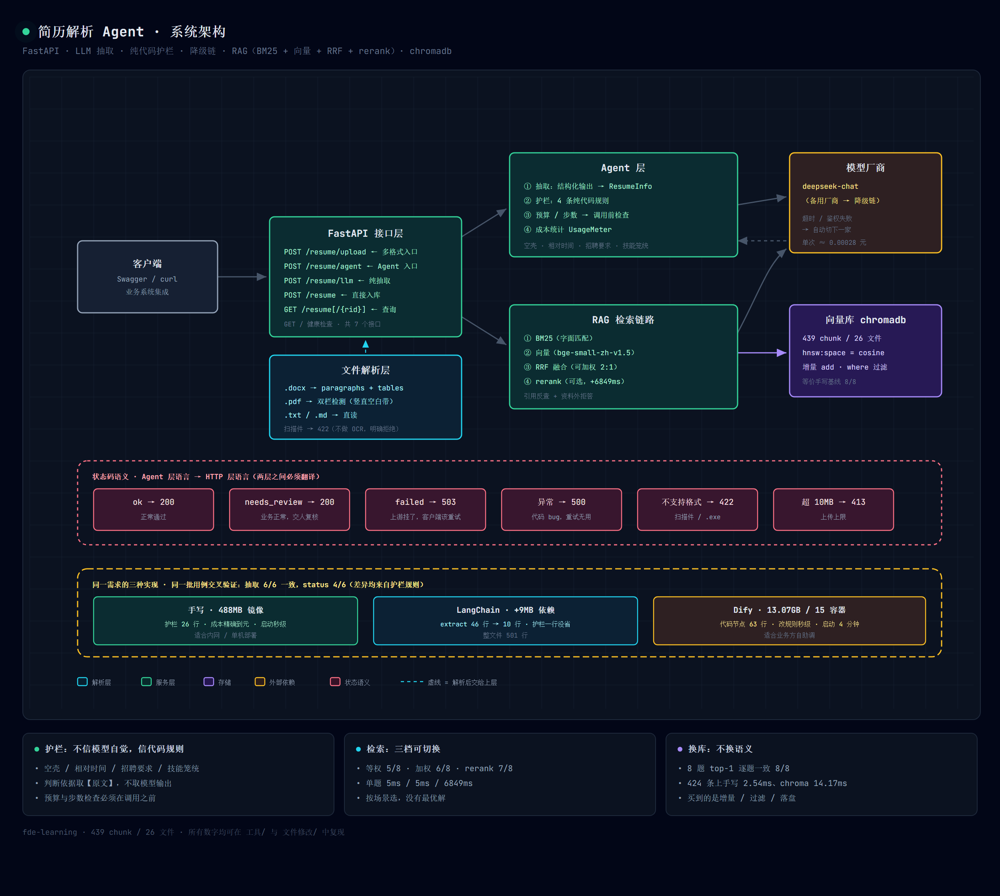
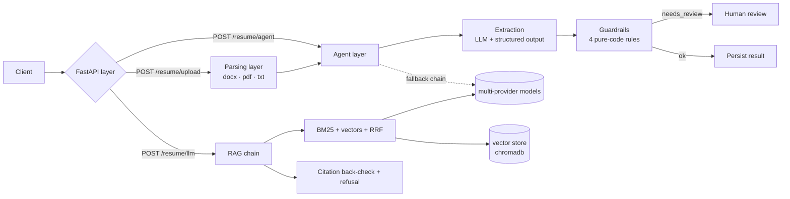

# Resume Parsing Agent

[中文](README.md) | **English**

A project that turns *resume → structured fields → business guardrails → HTTP service → grounded Q&A*
into something **shippable, verifiable, and comparable**.

The same requirement was implemented three ways (hand-written / LangChain / Dify) and cross-validated
against the same test suite.

> Backend engineer (Go/Gin + PHP, 3 years) moving toward AI delivery.
> The focus is not "making the model smarter" but **making AI output verifiable, interceptable,
> and cost-transparent**.

---

## Five ways to use it

| Way | Status | How |
|---|---|---|
| ① Local deployment | ✓ | `docker compose up -d` (or `tools/start_server.bat`) → open `http://127.0.0.1:8000/docs` |
| ② API | ✓ | Scoring: `POST /match/score` → `GET /match/report/{id}` (PDF)<br>Revisions: `POST /revise/review` → `POST /revise/apply` (two artifacts) |
| ③ Skill for agents | ✓ | Copy a folder from `skills/` into your agent's skills directory |
| ④ MCP client | ✓ | Optional: `pip install -r requirements-mcp.txt`, run `mcp_server.py` over stdio |
| ⑤ Single-page web UI | ✓ | Open `http://127.0.0.1:8000/ui` — two tabs: **Scoring** / **Resume revisions** |

**③ Two skills, different purposes**:

| skill | Audience | Purpose |
|---|---|---|
| [`skills/resume-job-matcher`](skills/resume-job-matcher/SKILL.md) | agents that must **call** it | One command: resume + JD → 100-point report + PDF |
| [`skills/match-scoring-design`](skills/match-scoring-design/SKILL.md) | people who want to **design** a similar system | Six design decisions + counter-examples + code locations |

Shortest path (no server needed):

```bash
python skills/resume-job-matcher/scripts/score.py --local \
  --resume resume.pdf --jd jd.txt --out report.pdf
```

Add `--json` for a machine-readable `MatchReport`. Exit codes: `0` success / `2` bad input /
`3` service unavailable / `4` internal error.

**④ Claude Desktop / MCP-capable clients**: install the main dependencies and configure `.env` first
(see Quick start), then `python -m pip install -r requirements-mcp.txt`. It uses mcp 2.x `MCPServer`;
read the [migration guide](https://py.sdk.modelcontextprotocol.io/v2/migration/) before upgrading to 3.x.

Configure `claude_desktop_config.json` (replace the placeholder path; use `/` on Windows):

```json
{
  "mcpServers": {
    "resume-agent": {
      "command": "<abs-path>/.venv/Scripts/python.exe",
      "args": ["<abs-path>/mcp_server.py"]
    }
  }
}
```

On macOS / Linux the interpreter is `<abs-path>/.venv/bin/python`. Tools exposed:
`parse_resume(resume_path)`, `score_match(resume_path, jd_text)`,
`make_report(resume_path, jd_text, out_path=None)`. Relative paths resolve from the project root;
PDF/DOCX up to 10 MB. `parse_resume` returns structured fields and character counts only —
the full resume text never enters tool output. Omit `out_path` to write the PDF into `reports/`.
Run `python tools/verify_mcp.py` for a real stdio acceptance test with CLI cross-check;
add `--offline` to check protocol and input guardrails without calling any model.

**⑤ Single-page web UI**: with the server running, open `http://127.0.0.1:8000/ui`.
Upload a resume, paste a JD, see the score and the per-item evidence, download the PDF — no Swagger,
no copying report IDs. The page has no CDN dependencies and stores nothing; a refresh clears it.
Keep the service bound to `127.0.0.1`; **v1 has no authentication — never expose it publicly.**

---

## Privacy

Resumes contain personal data. **Do not upload real resumes to a public deployment.**
Both `/match/score` and `/revise/review` process the resume text in memory; only the final files are
written to `reports/` (scoring PDF / revision PDF / rewritten resume) with a 30-minute TTL.
API responses never contain the full resume text. The web UI writes no `localStorage` and sets no cookies.

---

## What it does

| # | Capability | Key implementation |
|---|---|---|
| 1 | **Multi-format parsing** | `.docx` (incl. tables) / `.pdf` (incl. two-column) / `.txt` `.md`; scanned PDFs return 422 instead of empty text |
| 2 | **Structured extraction** | `name / years / skills` via prompt constraints + pydantic validation |
| 3 | **Guardrails in code** | empty-shell / relative-time / job-posting / vague-skills — **never relying on the model's good behaviour** |
| 4 | **Failure containment** | multi-provider fallback, retries, budget & step guardrails checked *before* the call, per-call cost to the yuan |
| 5 | **Grounded RAG** | retrieval + citation back-check + refusal; three retrieval modes (equal-weight / weighted RRF / rerank) |
| 6 | **Swap the implementation, keep the semantics** | hand-written numpy cosine ↔ chromadb: identical top-1 on 8/8 questions |
| 7 | **Score a resume against a JD** | 100 = hard 40 + semantic 30 + LLM 30; every point traces back to "which resume line, which JD line"; 7-section PDF |
| 8 | **Generate resume revisions against a JD** | five issue types → four-part structure (original / suggested / why / benefit); plus a rewritten resume that keeps your layout |

---

## Scoring and revisions against a JD

Both capabilities share the same JD extraction and guardrails; one *evaluates*, the other *rewrites*.

### Scoring (100 = 40 + 30 + 30)

| Layer | Points | How | Why split this way |
|---|---:|---|---|
| Hard | 40 | **Pure rules**: years 15 / education 10 / required skills 15 | Zero cost, zero uncertainty; when the model drifts you can immediately tell whether the model or the aggregation is at fault |
| Semantic | 30 | sentence split → bge-small-zh cosine **recall** → cross-encoder **decision** on coverage | Cosine alone cannot separate "same phrasing, different domain" — measured 0.711 for *"distributed database kernel"* against a Go/orders resume; after reranking, relevant pairs are positive and irrelevant ones negative |
| LLM review | 30 | stack depth 12 / domain fit 10 / proof strength 8 | The model emits sub-scores only — **it may never decide the total or the band** |

Hard rules: **unknown ≠ zero** (a resume without stated years yields `years_unknown` for human review,
not "not a match"); semantic score divides by **coverage** (matching 1 of 6 responsibilities must not
score like matching all 6); skills are de-duplicated by **concept family** (if the JD says "used
DeepSeek, Qwen, OpenAI, etc.", listing only DeepSeek is not a gap) — relaxation happens only inside a
family; a genuine gap is never forgiven.

### Revisions (two artifacts)

```
① Revision report PDF: header → summary → per-issue cards (four parts) → gaps
                     → ATS keyword coverage → "don't bother rewriting these" → revision comparison → audit footer
② Revised resume: .docx in → .docx out (paragraph-level replacement; fonts, tables, margins preserved)
                  .pdf  in → .pdf  out (single-column reflow, with an explicit notice that layout was reflowed)
```

**Four red lines that must never be crossed** (enforced in code, not by the model):

| Red line | Enforcement |
|---|---|
| No new terms absent from both the resume and the JD | whitelist check over tech terms / proper nouns; the issue is dropped |
| No altered numbers | every number must exist in the original resume ("two seconds → 2 seconds" normalisation is allowed) |
| Never turn "does not have it" into "has it" | `missing` issues **generate no suggested text**; only "add it if you genuinely have it" |
| No copying the JD to inflate the score | rewrites overlapping ≥ 0.7 with any JD line are rejected (copying the JD pushes the semantic score from 0 to 24) |

When `suggested_text` is empty or identical to the original, the PDF prints an explicit manual action
instead of a blank box: *"(cannot be written for you: add it under Skills if you truly have that
experience)"* / *"(fill this in yourself: use your real employment months — the system will not invent them)"*.

**Before/after scores**: hard 40 and semantic 30 are **recomputed exactly**; LLM 30 is **not re-run** —
the original score is reused and marked "estimated ±2". A negative delta is shown as-is, with a note
suggesting you adopt only some of the suggestions.

---

## Architecture





**Layering rule**: the agent layer speaks business language (`ok / needs_review / failed`), the HTTP
layer speaks protocol language (`200 / 422 / 503 / 500`), and the two must be translated explicitly.

---

## Quick start (5 minutes)

```bash
# 1. Dependencies
python -m venv .venv
.venv/Scripts/pip install -r requirements.txt          # Windows
# .venv/bin/pip install -r requirements.txt            # macOS / Linux

# 2. Configuration
cp .env.example .env
# Edit .env and set your own DEEPSEEK_API_KEY

# 3. Start from the project root
.venv/Scripts/python.exe -m uvicorn app.api:app --host 127.0.0.1 --port 8000

# 4. Open Swagger and click around
# http://localhost:8000/docs
```

The service binds to `127.0.0.1` only. v1 has no authentication — do not expose it publicly.

### Start with Docker Compose

On Linux, create the reports directory first (`mkdir -p reports`) and make sure the container user
`appuser` can write to it.

```bash
cp .env.example .env
# edit .env as above, then start
docker compose up -d
```

Then open [Swagger UI](http://127.0.0.1:8000/docs).

### First-run notes

- The vector model `bge-small-zh-v1.5` (~100 MB) downloads on first use; reranking additionally pulls
  `bge-reranker-base` (~1 GB). The image sets `HF_ENDPOINT=https://hf-mirror.com`, overridable at runtime.
- `docs/` is excluded by `.gitignore`, so a fresh clone has no RAG corpus — by design. Prepare the same
  corpus version locally to reproduce the evaluation.
- Both local and Compose setups publish only on the host's `127.0.0.1`. **v1 has no auth; keep it private.**

### Sample calls

```bash
# ① Agent: extraction + guardrails + fallback + cost
curl -X POST http://localhost:8000/resume/agent \
  -H "Content-Type: application/json" \
  -d '{"text":"Zhao Liu, started in 2016, left last year, backend"}'
# → {"status":"needs_review","reasons":["relative time: years need human confirmation"],...}

# ② Upload a real file (docx / pdf, ≤10MB)
curl -X POST http://localhost:8000/resume/upload \
  -F "file=@tools/test_files/table_resume.docx"

# ③ Scanned PDFs are explicitly rejected
curl -X POST http://localhost:8000/resume/upload \
  -F "file=@tools/test_files/scan_resume.pdf"
# → 422 this PDF has no text layer (likely a scan/image); OCR is required
```

**Scoring and revisions — the two commands you will actually use**

```bash
# Score: resume + JD → 100-point report + report_id
curl -X POST http://localhost:8000/match/score \
  -F "file=@tools/test_files/go_backend_resume.docx" \
  -F "jd_text=Backend engineer required: Go and MySQL..."
# → {"report_id":"...","report":{"score":{"total":90,...},"verdict":"strong match",...}}

# Revisions: job title only (profile draft → confirm → analyse)
curl "http://localhost:8000/revise/profile?job_title=FDE%20Delivery%20Engineer"
# → {"profile":{...},"profile_hash":"..."}
curl -X POST http://localhost:8000/revise/review \
  -F "file=@tools/test_files/go_backend_resume.docx" \
  -F "job_title=Backend Engineer" \
  -F "jd_text=Backend engineer required: Go and MySQL..."
# → {"review_id":"...","report":{"issues":[...],"score_before":90},"mode":"user_jd"}

# Apply: two artifacts at once (revision report + rewritten resume)
curl -X POST http://localhost:8000/revise/apply \
  -H "Content-Type: application/json" -d '{"review_id":"<id from the previous call>"}'
# → {"review_pdf_url":"/revise/file/<id>/review","resume_url":"/revise/file/<id>/resume",
#    "resume_ext":"docx","applied":[...],"skipped":[...],"delta":{...}}
```

---

## API

| Method | Path | Description | Codes |
|---|---|---|---|
| GET | `/` | Health check | 200 |
| POST | `/resume` | Store structured data directly | 200 |
| POST | `/resume/llm` | Pure LLM extraction (no guardrails) | 200 / 422 / 503 |
| POST | `/resume/agent` | **Agent: extraction + guardrails + fallback + cost** | 200 / 503 |
| POST | `/resume/upload` | Upload docx/pdf/txt/md, parse then run the agent | 200 / 413 / 422 |
| GET | `/resume` | Paginated list `?page=1&size=10` | 200 |
| GET | `/resume/{rid}` | Fetch one record | 200 / 404 |

**Scoring and revisions**

| Method | Path | Description | Codes |
|---|---|---|---|
| POST | `/match/score` | Resume + JD → 100-point report + `report_id` | 200 / 413 / 422 / 503 |
| GET | `/match/report/{report_id}` | Download the scoring PDF | 200 / 404 |
| GET | `/match/stats` | Cached report count and TTL | 200 |
| GET | `/revise/profile` | Job title → profile draft + fingerprint (**no model call**) | 200 / 422 |
| POST | `/revise/review` | Resume + job title + optional JD → revision report | 200 / 413 / 422 / 503 / 500 |
| POST | `/revise/apply` | Selected issues → two artifacts | 200 / 404 / 422 |
| GET | `/revise/file/{artifact_id}/{kind}` | Download, `kind ∈ {review, resume}` | 200 / 404 |
| GET | `/revise/stats` | Cached count and TTL | 200 |
| GET | `/ui` | Single-page web UI (two tabs) | 200 |

**Four job-input combinations**: JD provided (used as-is, most accurate) · job title only (profile draft,
**requires explicit user confirmation**) · JD only (allowed, prompts for a title) · neither (422).

**Two error codes worth remembering for revisions**: `422` means an input problem (scanned file / JD too
short / unconfirmed profile / empty selection); `503` means every model provider failed. This group
**never uses 400**.

### Status semantics (the most overlooked detail in delivery)

| Internal status | HTTP | What the client should do |
|---|---|---|
| `ok` | 200 | Normal |
| `needs_review` | **200** | Business-wise fine, hand it to a human (not an error) |
| `failed` (all providers down) | **503** | Retry |
| Uncaught exception | **500** | Fix the code; retrying will not help |

---

## Key design decisions

### 1. Why guardrails live in code, not in prompts

LLM failures are **silent**: HTTP 200, pydantic passes, the content is wrong.

```
{"name":null,"years":null,"skills":[]}   ← valid JSON, but nothing was extracted
```

`check_resume()` does four things in pure code:

| Rule | Trigger | Why a human, not a retry |
|---|---|---|
| Empty shell | all three fields empty | The source may genuinely lack the data; a retry will not invent it |
| Relative time | "last year / this year / currently / to date / fresh grad" | The model does not know today's date and will compute wrongly (measured: "started 2016, left last year" became 9 years) |
| Job posting | "requirements / qualifications / hiring" | This is a job description, not the person's history |
| Vague skills | `skills` empty although the text says "did backend" | Incomplete data that a human must fill in |

**Key lesson**: base rule decisions on the **original text**, never on **model output** — otherwise the
same input yields `["backend"]` one day and `[]` the next, and your verdict flips with it.

### 2. Budget and step guardrails must run before the call

```python
if len(steps) >= max_steps: return needs_review(...)
if cost >= budget_yuan:     return needs_review(...)
```

### 3. Evaluation must control contamination first

```
✗ questions inside the corpus   → you are testing "copy the answer"
✗ answers not in the corpus     → you are testing luck
✓ question text absent + answer present + corpus version recorded
```

### 4. Anchor every path to the file

```python
DEFAULT_PATH = Path(__file__).resolve().parent / ".chroma"   # ✓
path = "practice/.chroma"                                     # ✗ produces two stores per cwd
```

The customer's working directory is not under your control, so every path derives from `__file__`.

---

## Measured numbers

| Metric | Value | How to reproduce |
|---|---|---|
| Corpus size | 430 chunks / 25 files (local, not in the repo) | `rag.load_chunks()` |
| Retrieval recall | equal-weight 5/8 · weighted RRF 6/8 · rerank **7/8** | `tools/eval_retrieval.py` |
| Per-question latency | 5 ms · 5 ms · **6849 ms** | same |
| Vector store agreement | 8 questions, top-1 **8/8 identical** | `tools/eval_vector_store.py` |
| Vector store latency | hand-written 2.54–3.14 ms vs chroma 14.17–16.70 ms | two runs |
| Single extraction cost | **¥0.00028** | `UsageMeter` |
| Single scoring cost | **¥0.0018–0.0021** (3 model calls) | `tools/d1_check.py` |
| Single revision cost | **¥0.0049** (JD extraction + issue generation + LLM review) | `tools/verify_revise_http.py` |
| Semantic scoring latency | cold start 3.02 s (incl. model load) → **0.12–0.23 s** warm | `tools/check_semantic.py` |
| Scoring acceptance | **19/19** (6 resume×JD pairs, error codes, path traversal) | `tools/verify_match.py` |
| Revision acceptance | issue generation **17/17** · PDF **10/10** · layout preserved **18/18** · score delta **9/9** · end-to-end **34/34** | `tools/check_revision_*.py`, `verify_revise_http.py` |
| Docker image | **726 MB** (non-root, 0 real keys; includes fastembed/onnxruntime local inference) | `docker images` |
| API acceptance | 7/7 (incl. scanned 422 / 11 MB 413) | `tools/verify_delivery.py` |
| Behaviour parity across 3 versions | status 4/6, extraction 6/6 | see "Three implementations" |

> **About the corpus**: recall and latency were measured on the original study corpus
> (439 chunks / 26 files). The shipped local corpus has 430 chunks / 25 files, so recall may differ by
> ±1 question. The corpus itself is study material and is deliberately excluded from the repo
> (`.gitignore`): **evaluation must be reproducible, but the corpus does not belong in a code repository.**

> **About "swapping the store is faster"**: on 424 chunks chromadb is **5× slower** than the
> hand-written full cosine scan. What you buy is incremental `add`, metadata filtering and on-disk
> vectors — not speed at this scale.

---

## Three implementations compared

| Item | Hand-written | LangChain | Dify |
|---|---|---|---|
| Guardrails | `check_resume()` 26 lines | reuses the same code | code node, 63 lines |
| Deployment size | **726 MB** | 726 MB + 9 MB | **13.07 GB / 15 containers** |
| Startup | seconds | seconds | 4 min 05 s (40 s on restart) |
| Change one rule | edit + redeploy | edit + redeploy | **edit the node, instant** |
| Cost tracking | to the yuan | needs a callback | not shown in the panel |
| Best for | intranet, complex rules, must live in git | many models/data sources | business users tuning rules themselves |

> **Size lineage**: the hand-written version was 488 MB on Day 15 (LLM API calls only); adding
> embedding + cross-encoder reranking for the semantic layer took it to **726 MB**; during Docker
> hardening it briefly hit 1.05 GB because chromadb (used only for the store-swap comparison) dragged in
> `kubernetes` at 126 MB and ~324 MB in total — now back to 726 MB.

**A useful side effect of re-implementing**: while rewriting in Dify, the "job posting" rule turned out
to have an extra `is_student` condition that let pure job ads through — re-implementing something is
itself a code review.

---

## Project layout

```
resume-agent/
├─ app/                          # Application code
│  ├─ api.py                     # FastAPI layer (/resume* · /match* · /revise* · /ui)
│  ├─ agent.py                   # Agent: extract → guardrail → repair → result
│  ├─ schemas.py                 # Output schema (ResumeInfo / AgentResult)
│  ├─ prompts.py                 # Prompts (SYSTEM_RESUME / SYSTEM_JOB / SYSTEM_MATCH_RUBRIC / SYSTEM_REVISION)
│  ├─ providers.py               # Provider definitions + cost meter (UsageMeter)
│  ├─ fallback.py                # Async calls + fallback chain
│  ├─ resilience.py              # Timeouts + exponential backoff
│  ├─ file_parser.py             # Word/PDF parsing (tables + two-column + scans)
│  ├─ rag.py                     # RAG: BM25 / vectors / RRF / rerank / refusal
│  ├─ vector_store.py            # chromadb retrieval (equivalent to the hand-written baseline)
│  ├─ langchain_extract.py       # LangChain extraction (for comparison)
│  ├─ langchain_agent.py         # LangChain fallback + repair (for comparison)
│  ├─ check_agent.py             # 6 assertion self-checks
│  ├─ check_vector_store.py      # 3 assertion self-checks
│  │
│  ├─ ── scoring (S0–S7b) ──
│  ├─ schemas_match.py           # JobInfo / MatchReport / Deduction / SemanticItem
│  ├─ job_parser.py              # JD → JobInfo (3 guardrails)
│  ├─ resume_parser.py           # File → text + ResumeInfo (raises on scans)
│  ├─ scoring_rules.py           # Hard 40 (pure rules + SKILL_FAMILIES)
│  ├─ scoring_semantic.py        # Semantic 30 (cosine recall + cross-encoder decision + coverage)
│  ├─ scoring_llm.py             # LLM review 30 (evidence checks + suggestion whitelist)
│  ├─ match_pipeline.py          # Orchestration: parse → three layers → aggregate
│  ├─ match_report.py            # Total / band (85/70/55) / gaps / suggestions
│  ├─ report_pdf.py              # Scoring PDF (7 sections + four-state comparison table)
│  ├─ report_store.py            # TTL store for reports and artifacts (traversal-safe)
│  ├─ pdf_kit.py                 # Shared PDF layout primitives (tables/fonts/truncation/footer)
│  │
│  ├─ ── revisions (M0–M7) ──
│  ├─ schemas_revision.py        # ReviewIssue / JobProfile / DiagnosisReport / ScoreDelta
│  ├─ guard_revision.py          # Red lines: new terms / new numbers / original must be findable
│  ├─ resume_diagnose.py         # Defect diagnosis (8 codes) + ATS keyword coverage
│  ├─ job_profile.py             # Job family templates + fingerprint + confirmation flow
│  ├─ revision_llm.py            # Issue generation (7 guardrails + gap consistency + JD-overlap gate)
│  ├─ revision_pdf.py            # Revision PDF (7 sections + three-state rendering + "don't rewrite")
│  ├─ resume_rewrite.py          # In-place docx rewriting / PDF reflow / two artifacts
│  ├─ score_delta.py             # Before/after scores (hard+semantic exact, LLM estimated)
│  ├─ revise_pipeline.py         # Orchestration: profile → diagnosis → issues → delta → apply
│  └─ static/index.html          # Single-page UI (two tabs, no CDN, no local storage)
├─ tools/                        # Evaluation and verification
│  ├─ bootstrap.py               # Import bootstrap for tool scripts
│  ├─ eval_retrieval.py          # 8 questions × three retrieval modes
│  ├─ eval_vector_store.py       # 8 questions, dual run, compare top-1
│  ├─ verify_delivery.py         # 11 delivery checks
│  ├─ verify_match.py            # 19 scoring API checks
│  ├─ verify_mcp.py              # 14 MCP stdio checks
│  ├─ check_job_parser.py        # 8 JD extraction checks
│  ├─ check_resume_parser.py     # 4 resume input checks
│  ├─ check_scoring_rules.py     # 13 hard-score checks
│  ├─ check_semantic.py          # 9 semantic-score checks
│  ├─ check_llm_score.py         # 7 LLM review checks
│  ├─ check_match_report.py      # 15 aggregation checks
│  ├─ check_report_pdf.py        # 9 scoring PDF checks
│  ├─ check_revision_guard.py    # 8 red-line checks
│  ├─ check_resume_diagnose.py   # 12 diagnosis checks
│  ├─ check_job_profile.py       # 14 profile checks
│  ├─ check_revision_llm.py      # 17 issue-generation checks
│  ├─ check_revision_pdf.py      # 10 revision PDF checks
│  ├─ check_resume_rewrite.py    # 18 layout-preservation checks
│  ├─ check_score_delta.py       # 9 score-delta checks
│  ├─ verify_revise_http.py      # 34 end-to-end revision checks
│  ├─ make_test_files.py         # Generate test docx/pdf
│  └─ test_files/                # Test resumes (incl. a scanned PDF and a high-scoring sample)
├─ skills/                       # Two agent skills (capability / methodology)
├─ mcp_server.py                 # MCP server (stdio, 3 tools)
├─ demo/                         # Demo materials
│  ├─ 架构图.png / .html         # architecture diagram (Chinese labels)
│  └─ 演示脚本.md                # 3-minute talk track (Chinese)
├─ .env.example
├─ requirements.txt / requirements-mcp.txt / requirements-optional.txt
└─ Dockerfile                    # 726 MB, non-root, no secrets
```

---

## Docker

> Prefer the Docker Compose steps above. If you run the command below manually, publish the port as
> `-p 127.0.0.1:8000:8000` so the host only exposes it on loopback.

```bash
docker build -t resume-ai:latest .
docker run -p 127.0.0.1:8000:8000 --env-file .env resume-ai:latest
```

Image is **726 MB** (`docker images`), runs as a non-root user, and `.dockerignore` excludes `.env`
(scanned: 0 real secrets). The hand-written-vs-chromadb comparison needs `requirements-optional.txt`;
the runtime image excludes chromadb (it drags in ~300 MB of kubernetes dependencies).

---

## Limits and not-done

| Item | Note |
|---|---|
| No OCR | Scanned PDFs are rejected with 422 |
| No streaming | Everything returns synchronously |
| No authentication | Single-machine demo; no JWT / API key |
| In-memory storage | Data is lost on restart; no database |
| Dify version has no fallback chain | Platform capability, not validated here |
| **A PDF resume cannot keep its layout** | PDFs are not editable, so we can only reflow to a single column — upload `.docx` to preserve layout |
| **Text inside text boxes / WordArt / headers is not rewritten** | Those runs are unreachable; they are reported as "change manually" |
| **docx files with tracked changes are rejected wholesale** | Rewriting would scramble someone else's pending revisions; accept/reject them in Word first |
| **The rewritten resume keeps its structure** | No added/removed paragraphs, no reordered sections, no font changes — only the selected lines are replaced |
| No batch mode / no history for revisions | A refresh clears everything; v1 stores no resume content |
| Historical bug in the job-posting rule | **Fixed in this repo** (an extra `is_student` condition let pure job ads through); rationale in the rule-3 comment in `app/agent.py` |

---

## Roadmap

| Feature | Depends on | Status |
|---|---|---|
| ① Resume keyword parsing | — | ✅ |
| ② Score a resume against a JD (per-item, evidence-traceable) | JD extraction + matching engine | ✅ |
| ③ Generate resume revisions against a JD (no fabrication) | ②'s diff | ✅ (incl. rewritten resume and score delta) |
| ④ Generate interview Q&A from JD + resume | ②'s diff | ⬜ |

Shared abstraction: JD extraction and resume extraction reuse the same guardrails and structured output;
the score = rules + semantics + LLM review, and **every point must trace back to "which resume line,
which JD line"**. Revisions follow the same chain: **every suggestion must point back to an original
line and may never introduce facts beyond the resume and the JD.**

---

## License

Personal learning project; free to reference.
