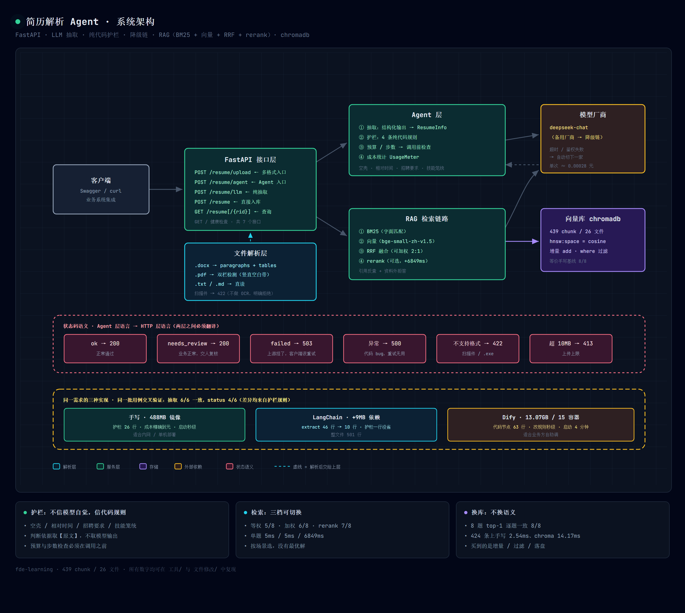
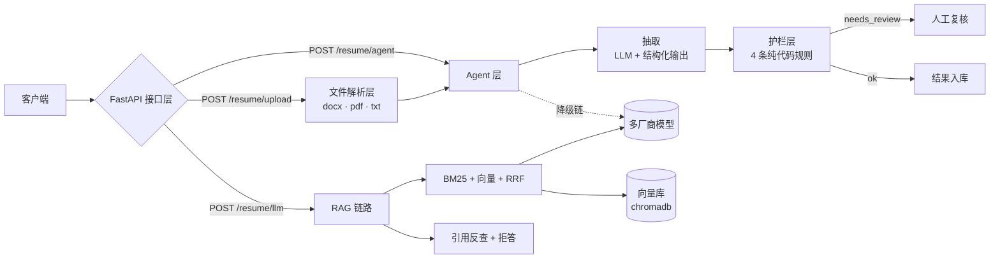

# Resume Parsing Agent · 简历解析 Agent

把「简历 → 结构化字段 → 业务护栏 → HTTP 服务 → 基于资料的问答」做成一个**能交付、能验证、能对比**的项目。

同一套需求做了三种实现（手写 / LangChain / Dify），用同一批用例交叉验证。

> 后端出身（Go/Gin + PHP，3 年）转 AI 交付方向，这是补「LLM 应用交付」这一层的实操项目。
> 关注点不是「让模型更聪明」，而是 **让 AI 的结果可验证、可拦截、可解释成本**。

## 三种使用方式

| 方式 | 状态 | 如何使用 |
|---|---|---|
| ① 本地部署 | ✓ | `docker compose up -d`（或 `tools/start_server.bat`）→ 打开 `http://127.0.0.1:8000/docs` |
| ② API 调用 | ✓ | `POST /match/score`（上传简历 + JD）→ `GET /match/report/{report_id}` 下载 PDF |
| ③ Skill 给 agent | ✓ | 把 `skills/` 下的目录复制到你 agent 的 skills 目录；见下 |

**③ 两个 skill，用途不同**：

| skill | 给谁 | 干什么 |
|---|---|---|
| [`skills/resume-job-matcher`](skills/resume-job-matcher/SKILL.md) | 想让 agent **会调用**的 | 一条命令：简历 + JD → 100 分报告 + PDF |
| [`skills/match-scoring-design`](skills/match-scoring-design/SKILL.md) | 想**照着设计**同类系统的 | 六个设计决策 + 反例 + 各自代码落点 |

最短用法（不需要起服务）：

```bash
python skills/resume-job-matcher/scripts/score.py --local \
  --resume 简历.pdf --jd jd.txt --out 报告.pdf
```

加 `--json` 输出机器可读的 `MatchReport`；退出码 `0` 成功 / `2` 输入错误 / `3` 服务不可用 / `4` 内部错误。

## 隐私提醒

简历包含个人敏感信息。**请勿将真实简历上传到公共部署环境。**
`/match/score` 在内存中处理简历原文，服务端只将最终 PDF 写入 `reports/`，有效期为 30 分钟。

---

## 能做什么

| # | 能力 | 关键实现 |
|---|---|---|
| 1 | **多格式简历解析** | `.docx`（含表格）/ `.pdf`（含双栏）/ `.txt` `.md`；扫描件明确返回 422 而不是空内容 |
| 2 | **结构化抽取** | `name / years / skills`，提示词约束 + pydantic 校验 |
| 3 | **业务护栏（纯代码）** | 空壳 / 相对时间 / 招聘要求 / 技能笼统 四条规则，**不依赖模型自觉** |
| 4 | **容错与止损** | 多厂商降级链、重试、预算与步数护栏（调用**前**检查）、单次成本精确到元 |
| 5 | **RAG 问答** | 检索 + 引用反查 + 资料外拒答；三档检索（等权 / 加权 RRF / rerank）可切换 |
| 6 | **换实现不改语义** | 手写 numpy 余弦 ↔ chromadb，8 题 top-1 逐题一致 |

---

## 架构





**分层原则**：Agent 层说业务语言（`ok / needs_review / failed`），HTTP 层说协议语言（`200 / 422 / 503 / 500`），两层之间必须翻译。

---

## 快速开始（5 分钟）

```bash
# 1. 依赖
python -m venv .venv
.venv/Scripts/pip install -r requirements.txt          # Windows
# .venv/bin/pip install -r requirements.txt            # macOS / Linux

# 2. 配置
cp .env.example .env
# 编辑 .env，填入自己的 DEEPSEEK_API_KEY

# 3. 从项目根目录启动
.venv/Scripts/python.exe -m uvicorn app.api:app --host 127.0.0.1 --port 8000

# 4. 打开 Swagger 点着测
# http://localhost:8000/docs
```

服务默认仅监听 `127.0.0.1`，v1 没有鉴权，不要直接暴露公网。

### 用 Docker Compose 启动

在 Linux 上，请先用 `mkdir -p reports` 创建报告目录，并确保容器内的 `appuser` 可以写入。

```bash
cp .env.example .env
# 按上面的配置步骤编辑 .env，再启动服务
docker compose up -d
```

打开 [Swagger UI](http://127.0.0.1:8000/docs) 试用接口。

### 首次运行要注意

- 首次使用向量模型时会下载 `bge-small-zh-v1.5`（约 100 MB），首次使用重排时会另行下载 `bge-reranker-base`（约 1 GB）。镜像内置 `HF_ENDPOINT=https://hf-mirror.com`，可在运行时覆盖。
- `docs/` 由 `.gitignore` 排除，克隆后 RAG 语料为空是刻意设计。复现评测时请在本地准备相同版本的语料。
- 本地启动和 Docker Compose 默认都只通过宿主机 `127.0.0.1` 提供访问。**v1 无鉴权，请勿暴露到公网。**

### 三种调用方式

```bash
# ① Agent：抽取 + 护栏 + 降级链 + 成本统计
curl -X POST http://localhost:8000/resume/agent \
  -H "Content-Type: application/json" \
  -d '{"text":"赵六，2016 年入行，去年离职，做后端"}'
# → {"status":"needs_review","reasons":["相对时间:年限需人工确认"],...}

# ② 上传真实文件（docx / pdf，≤10MB）
curl -X POST http://localhost:8000/resume/upload \
  -F "file=@tools/test_files/table_resume.docx"

# ③ 扫描件会被明确拒绝
curl -X POST http://localhost:8000/resume/upload \
  -F "file=@tools/test_files/scan_resume.pdf"
# → 422 这份 PDF 没有文本层（很可能是扫描件/图片），需要 OCR 才能解析
```

---

## 接口清单

| 方法 | 路径 | 说明 | 状态码 |
|---|---|---|---|
| GET | `/` | 健康检查 | 200 |
| POST | `/resume` | 结构化数据直接入库 | 200 |
| POST | `/resume/llm` | 纯 LLM 抽取（无护栏） | 200 / 422 / 503 |
| POST | `/resume/agent` | **Agent：抽取 + 护栏 + 降级 + 成本** | 200 / 503 |
| POST | `/resume/upload` | 上传 docx/pdf/txt/md 解析后走 Agent | 200 / 413 / 422 |
| GET | `/resume` | 分页列表 `?page=1&size=10` | 200 |
| GET | `/resume/{rid}` | 按 ID 查询 | 200 / 404 |

### 状态码语义（交付现场最容易被忽略的一条）

| 内部状态 | HTTP | 客户端该做什么 |
|---|---|---|
| `ok` | 200 | 正常 |
| `needs_review` | **200** | 业务正常，交人复核（不是错） |
| `failed`（上游全挂） | **503** | 该重试 |
| 未捕获异常 | **500** | 该改代码，重试无用 |

---

## 关键设计

### 1. 护栏为什么写在代码里，不写在提示词里

LLM 的失败是**静默的**：接口 200、pydantic 通过、内容是错的。

```
{"name":null,"years":null,"skills":[]}   ← 合法 JSON，但什么都没抽到
```

`check_resume()` 用纯代码做四件事：

| 规则 | 触发条件 | 为什么交人而不是让模型重试 |
|---|---|---|
| 空壳 | 三字段全空 | 原文可能就没有信息，重试也抽不出来 |
| 相对时间 | 含「去年/今年/目前/至今/现在/应届」 | 模型不知道今天几号，硬算必错（实测把「2016 入行、去年离职」算成 9 年） |
| 招聘要求 | 含「岗位要求/任职要求/招聘」 | 这是岗位描述，不是本人经历 |
| 技能笼统 | skills 为空但原文写了「做后端」 | 数据不完整，下游需要人补 |

**关键教训**：规则判断依据要取**原文**，不能取**模型输出** ——
否则同一条输入，模型这次输出 `["后端"]`、下次输出 `[]`，判定就跟着飘。

### 2. 预算与步数护栏必须在调用之前

```python
if len(steps) >= max_steps: return needs_review(...)
if cost >= budget_yuan:     return needs_review(...)
```

### 3. 评测必须先防污染

```
✗ 评测题写在语料里   → 测的是「抄答案」
✗ 答案不在语料里     → 测的是运气
✓ 题目文字不在语料 + 答案在语料 + 标注语料版本
```

### 4. 路径必须锚定到文件位置

```python
DEFAULT_PATH = Path(__file__).resolve().parent / ".chroma"   # ✓
path = "练习/.chroma"                                          # ✗ 换目录就生成两个库
```

客户内网的启动目录不可控，所有路径都从 `__file__` 派生。

---

## 实测数字

| 指标 | 数值 | 复现方式 |
|---|---|---|
| 语料规模 | 430 chunk / 25 文件（本地语料，未进仓库） | `rag.load_chunks()` |
| 检索三档命中 | 等权 5/8 · 加权 RRF 6/8 · rerank **7/8** | `tools/eval_retrieval.py` |
| 单题延迟 | 5 ms · 5 ms · **6849 ms** | 同上 |
| 向量库一致性 | 8 题 top-1 **8/8 相同** | `tools/eval_vector_store.py` |
| 向量库延迟 | 手写 2.54~3.14 ms vs chroma 14.17~16.70 ms | 两次实测 |
| 单次抽取成本 | **0.00028 元** | `UsageMeter` |
| Docker 镜像 | **726 MB**（非 root、0 个真 key；含 fastembed/onnxruntime 本地推理）| `docker images` |
| 接口用例 | 7/7 通过（含扫描件 422 / 11MB 413） | `tools/verify_delivery.py` |
| 三版本行为一致 | status 4/6、抽取 6/6 | 见下方「三种实现」 |

> **关于语料**：检索命中率与延迟在原始学习语料（439 chunk / 26 文件）上实测；
> 本仓库随附的本地语料为 430 chunk / 25 文件，复现时命中率可能有 ±1 题偏差。
> 语料本身是学习文档，未随仓库分发（`.gitignore` 里的 `docs/`），这是刻意的：
> **评测要能复现，但语料不该进代码仓库**。

> **关于「换库更快」**：424 个 chunk 上 chromadb 比手写全量余弦**慢 5 倍**。
> 换库买到的是增量 add、metadata 过滤、向量落盘 —— 不是当前规模的性能。

---

## 三种实现对照

| 项 | 手写 | LangChain | Dify |
|---|---|---|---|
| 护栏 | `check_resume()` 26 行 | 复用同一份 | 代码节点 63 行 |
| 部署体积 | **726 MB** | 726 MB + 9 MB | **13.07 GB / 15 容器** |
| 启动 | 秒级 | 秒级 | 4 分 05 秒（重启 40 秒） |
| 改一条规则 | 改代码重跑 | 改代码重跑 | **改节点秒级生效** |
| 成本统计 | 精确到元 | 需挂 callback | 面板不显示 |
| 适用 | 内网、规则复杂、要进 git | 多模型多数据源 | 业务方自助调 |

> **体积口径说明**：Day15 时手写版是 488 MB（只有大模型 API 调用）；S4 语义分引入
> 本地 embedding + cross-encoder 重排（fastembed/onnxruntime）后增至 **726 MB**；
> D1 时把只用于「换库对照」的 chromadb 移出运行时依赖，从 1.05 GB 降回 726 MB
> （chromadb 会拖进 kubernetes 126 MB 等约 324 MB）。

**复刻的副产品**：用 Dify 重写一遍时，发现手写版「招聘要求」拦截条件多写了一个 `is_student`，
导致纯招聘广告被放行 —— 换一种实现复刻，本身就是一次代码 review。

---

## 目录结构

```
resume-agent/
├─ app/                          # 业务代码
│  ├─ api.py                     # FastAPI 接口层（7 个接口）
│  ├─ agent.py                   # Agent：抽取 → 护栏 → 修复 → 结果
│  ├─ schemas.py                 # 结构化输出 schema（ResumeInfo / AgentResult）
│  ├─ prompts.py                 # 提示词（SYSTEM_RESUME 等）
│  ├─ providers.py               # 多厂商定义 + 成本统计（UsageMeter）
│  ├─ fallback.py                # 异步调用 + 降级链
│  ├─ resilience.py              # 超时控制 + 指数退避
│  ├─ file_parser.py             # Word/PDF 解析（表格 + 双栏 + 扫描件）
│  ├─ rag.py                     # RAG：BM25 / 向量 / RRF / rerank / 拒答
│  ├─ vector_store.py            # chromadb 版检索（等价手写基线）
│  ├─ langchain_extract.py       # LangChain 版抽取（对照用）
│  ├─ langchain_agent.py         # LangChain 版 fallback + repair（对照用）
│  ├─ check_agent.py             # 6 条用例自检
│  └─ check_vector_store.py      # 3 条断言自检
├─ tools/                        # 评测与验证
│  ├─ bootstrap.py               # 工具脚本的导入引导
│  ├─ eval_retrieval.py          # 8 题 × 三档检索
│  ├─ eval_vector_store.py       # 8 题双跑，比 top-1
│  ├─ verify_delivery.py         # 11 条交付验证
│  ├─ make_test_files.py         # 生成测试 docx/pdf
│  └─ test_files/                # 4 份测试简历
├─ demo/                         # 演示材料
│  ├─ 架构图.png / .html
│  └─ 演示脚本.md                # 3 分钟逐句讲稿
├─ .env.example
├─ requirements.txt
└─ Dockerfile                    # 726MB，非 root，无密钥
```

---

## Docker

> 请优先使用快速开始里的 Docker Compose 步骤。手动运行下方示例时，请将端口参数设为 `-p 127.0.0.1:8000:8000`，让宿主机仅在回环地址上发布端口。

```bash
docker build -t resume-ai:latest .
docker run -p 8000:8000 --env-file .env resume-ai:latest
```

镜像 **726 MB**（`docker images` 实测），非 root 用户运行，`.dockerignore` 排除 `.env`（扫过：0 个真实密钥）。
手写 RAG vs chromadb 换库对照需要额外安装 `requirements-optional.txt`，运行时镜像不含 chromadb（它会把 kubernetes 等 300MB 拖进来）。

---

## 限制与未做

| 项 | 说明 |
|---|---|
| 无 OCR | 扫描件直接 422 拒绝 |
| 无流式输出 | 全部同步返回 |
| 无鉴权 | 单机 demo，未接 JWT / API Key |
| 存储是内存 | 重启丢数据，没接数据库 |
| Dify 版无降级链 | 平台能力，本次未验证 |
| 招聘要求规则的旧版本 bug | **本仓库已修复**（旧条件多了 `is_student`，纯招聘广告会被放行）；修复原因见 `app/agent.py` 规则 3 注释 |

---

## 规划中

| 功能 | 依赖 | 状态 |
|---|---|---|
| ① 简历关键字解析 | 已有 | ✅ |
| ② 对照 JD 给简历打分（分项 + 证据可回溯） | 新增 JD 抽取 + 匹配引擎 | ⬜ |
| ③ 对照 JD 生成简历修改意见（禁止编造事实） | ② 的差异项 | ⬜ |
| ④ 对照 JD + 简历生成面试问答 | ② 的差异项 | ⬜ |

统一抽象：JD 抽取与简历抽取复用同一套护栏与结构化输出；
匹配分数 = 规则项 + 语义项 + LLM 复核，**每一分都要能追溯到「简历哪句、JD 哪句」**。

---

## 许可

个人学习项目，可自由参考。
